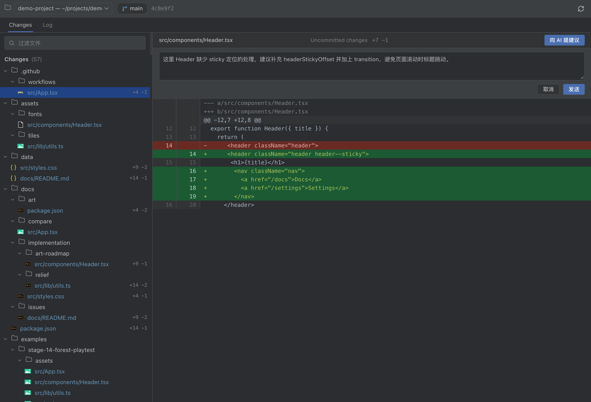

# dsh-git-control · Read-only Git panel for DeepSeek Harness

> Look at Git the way you would in IntelliJ IDEA, right inside [DeepSeek Harness](https://github.com/deepseek-ai/deepseek-harness) — **pure read-only, zero risk of accidental writes**.

[](LICENSE)
[](https://lucide.dev)
[](https://github.com/vscode-icons/vscode-icons)
[](https://github.com/deepseek-ai/deepseek-harness)

A Harness plugin styled after the **IntelliJ IDEA Git tool window** (Darcula palette): repository status, file diffs, commit history, and per-commit details — **look, don't touch**.

## Why "pure read-only"?

- No staging, no commits, no rollback, no branch switching — **no write operations anywhere in the UI**
- The Host exposes only **4 read-only GET routes** (status / diff / log / commit); there is no write API at all
- When you actually need to change something, use the git CLI or your IDE. The panel's only job is to make the repository state crystal clear.

## ✨ Features

| | |
|---|---|
| 🎯 **Auto-follows your project** | Open the panel and it shows the project you are working on; switch projects and the panel follows |
| 🎨 **JetBrains look & feel** | Darcula palette, Changes / Log tabs, directory-grouped change tree, blue selection, branch badge |
| 🗂 **File-type icons** | 40+ extensions (TS / JS / Python / Go / Rust / JSON / Markdown / Docker…); untracked files render gray |
| 🔢 **Per-file line stats** | `+n −m` right in the tree; files changed in both the index and the worktree show a **combined two-section diff** |
| 📄 **Numbered unified diff** | JetBrains Darcula diff colors (green add / red delete / gray hunk), old and new line numbers side by side |
| 🌿 **Commit graph + details** | Multi-color lanes, smooth Bézier merge lines, branch labels; click any commit for author / date / parents / file list / full diff |
| 🐘 **Large-repo friendly** | Change list truncates at 500 entries with a total hint, plus a file filter box |
| 🌐 **Bilingual** | UI copy follows the Harness language (Chinese / English) |
| 💬 **One-click "suggest to AI"** | While reviewing, type a suggestion right in the panel and send it to a new project conversation — no window switching; the agent picks it up immediately |

## 📸 Screenshots

**Changes view** — directory-grouped change tree (file-type icons, line stats) with a numbered unified diff on the right:


**Suggest to AI** — write a review suggestion in the panel and send it to a new project conversation (path only by default; selected diff lines are optional):



**Log view** — multi-color commit graph and branch labels; click any commit to expand the details pane below (author, date, changed files, full diff):


## 🚀 Install

This is a Harness plugin bundle (plain JavaScript, no build step). Install this repository directory through the Harness plugin manager:

```bash
# Option 1: install the directory via the plugin manager (install_bundle)
# Option 2: command line
dsh --profile <profile-name> plugin install /path/to/dsh-git-control
```

> The package name `@local/dsh-git-control` follows the local-scope convention: this plugin is installed from a directory and is not published to npm.

## 📖 Usage

1. Click the **Git** icon in the left sidebar to open the panel
2. The panel **auto-binds to the current project**; use the toolbar repository dropdown to inspect other registered workspaces
3. **Changes tab**: the filter box at the top filters by path; click any file to view its diff on the right
4. **Log tab**: click any commit row to expand its details below (file list + full diff)
5. **Suggest to AI**: use the toolbar without opening a file or an existing chat, or open the composer from a diff or commit. Only your suggestion and relative path (or commit hash) are included by default. Click diff lines to attach selected code. Every send creates and opens a new project conversation.

## 🏗 Architecture

- **Host** (`index.js`): runs git through `ctx.subprocess` (clears inherited `GIT_*` environment variables, `GIT_TERMINAL_PROMPT=0`) and registers 4 **read-only GET routes** plus 1 **chat-bridge POST route** inside the Harness Connection authentication fence:
  - `/api/git.status` — repository status + per-file numstat line statistics
  - `/api/git.diff` — single-file diff (staged / worktree / combined / untracked)
  - `/api/git.log` — commit history (with parents, for the commit graph)
  - `/api/git.commit` — per-commit metadata + file stats + full diff
  - `/api/git.review` — creates a workspace conversation and delivers the review suggestion (the same `ctx.sessionController.prompt` the chat input uses, `mode: 'queue'`; never touches git)
  - Safety: `cwd` must be a registered workspace path; file paths reject absolute paths / `..` / leading `-`; commit hashes accept hex only; session ids and message length are bounded
- **Client** (`client.js`): plain JavaScript, no build step, registered through the `sidebar.panellist` + `main` keyed slots; Darcula palette (`#2B2D30` / `#3C3F41` / `#1B5A33` / `#6A2A24`…); copy goes through the Harness locale service (zh / en)

## ✅ Verified

- Tested in the **DeepSeek Harness desktop app (0.2.1-rc.3)** Web GUI: panel registration, auto-follow of the current project, the three change groups, diffs, commit graph and commit details all work
- Read-only check: `POST /api/git.ops` returns 404 — the Host exposes no git write routes
- `node --test test/*.test.mjs`: distinct workspace sessions, input validation, recovery after rejected admission, and opening a new chat without selecting a file.
- When admission is uncertain, inspect the created conversation before retrying.
- Screenshots are real captures of the rendered panel (demo content)

## 🎁 Icons & License

- Control icons: [Lucide](https://lucide.dev) (ISC License)
- File-type icons: [vscode-icons](https://github.com/vscode-icons/vscode-icons) (MIT License)
- Plugin code: [MIT License](LICENSE)
