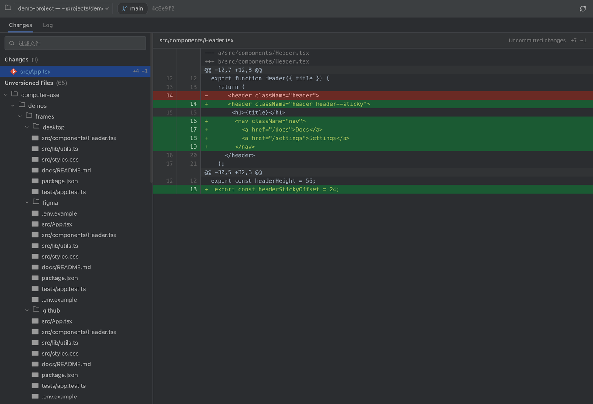
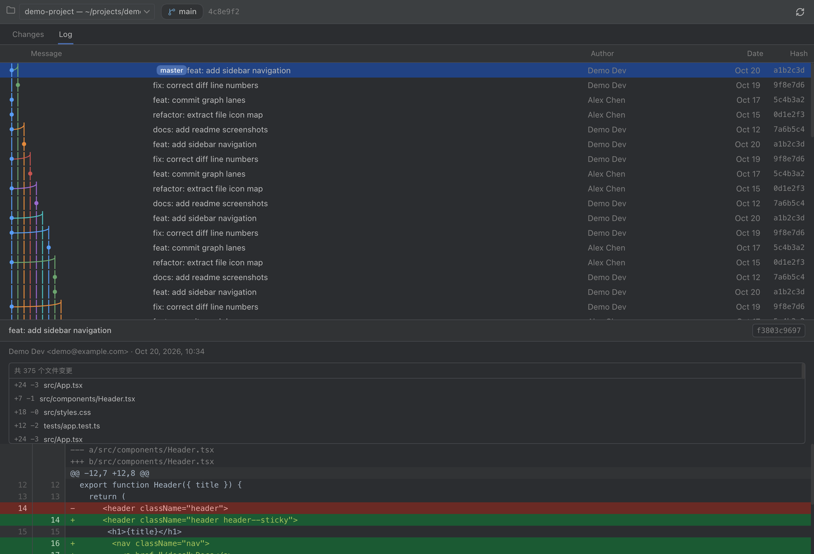

# dsh-git-control · DeepSeek Harness 纯只读 Git 面板

> 在 [DeepSeek Harness](https://github.com/deepseek-ai/deepseek-harness) 里，像用 IntelliJ IDEA 一样「看」Git —— **纯只读，零操作风险**。

[](LICENSE)
[](https://lucide.dev)
[](https://github.com/vscode-icons/vscode-icons)
[](https://github.com/deepseek-ai/deepseek-harness)

一个完全仿照 **IntelliJ IDEA Git 工具窗口**（Darcula 配色）的 Harness 插件：
仓库状态、文件差异、提交历史、单提交详情——**只看不动**。

## 为什么是「纯只读」？

- 没有暂存、没有提交、没有回滚、没有切换分支——**面板上没有任何写操作**
- Host 端只暴露 **4 条只读 GET 路由**（status / diff / log / commit），没有写操作 API，想写也写不了
- 需要动手时用 git 命令行或 IDE 自己来；面板只负责把仓库状态**讲清楚**

## ✨ 特性

| | |
|---|---|
| 🎯 **自动跟随当前项目** | 打开面板即显示你正在操作的项目；切换到别的项目，面板自动跟随 |
| 🎨 **JetBrains 风格** | Darcula 配色、Changes / Log 双标签、目录分组变更树、蓝色选中态、分支徽标 |
| 🗂 **按文件类型显示图标** | 40+ 种扩展名（TS / JS / Python / Go / Rust / JSON / Markdown / Docker…），未跟踪文件显示灰色 |
| 🔢 **每文件行数统计** | 变更树行尾直接显示 `+n −m`；暂存 + 工作区同时有变更的文件**合并展示两段 diff** |
| 📄 **带行号的统一 diff** | JetBrains Darcula diff 配色（增绿 / 删红 / hunk 灰），新旧行号对照 |
| 🌿 **提交图 + 提交详情** | 多色泳道、贝塞尔平滑合并线、分支标签；点开任意提交：作者 / 时间 / 父提交 / 文件列表 / 完整 diff |
| 🐘 **大仓库友好** | 变更列表自动截断（前 500 条并提示总数）+ 文件过滤框 |
| 🌐 **中英双语** | 界面文案跟随 Harness 语言（中文 / English） |

## 📸 截图

**Changes 视图**——目录分组的变更树（按文件类型显示图标、行数统计），右侧为带行号的统一 diff：



**Log 视图**——多色提交图与分支标签；点击任意提交，底部展开详情面板（作者、时间、变更文件列表与完整 diff）：



## 🚀 安装

这是一个 Harness 插件 bundle（纯 JavaScript、无构建步骤）。在 Harness 的插件管理器中安装本仓库目录即可：

```bash
# 方式一：插件管理器安装本地目录（install_bundle）
# 方式二：命令行安装
dsh --profile <profile名> plugin install /path/to/dsh-git-control
```

> 包名 `@local/dsh-git-control` 是本地作用域约定：本插件通过目录安装，不发布到 npm。

## 📖 使用

1. 左侧边栏点击 **Git** 图标打开面板
2. 面板**自动绑定当前项目**；点击工具栏仓库下拉可切换查看其他已注册工作区
3. **Changes 标签**：顶部输入框可按路径过滤；点击任意文件即可在右侧查看 diff
4. **Log 标签**：点击任意提交行，底部展开该提交的详情（文件列表 + 完整 diff）

## 🏗 架构

- **Host**（`index.js`）：通过 `ctx.subprocess` 运行 git（清除继承的 `GIT_*` 环境变量、`GIT_TERMINAL_PROMPT=0`），在 Harness Connection 认证栅栏内注册 4 条**只读 GET 路由**：
  - `/api/git.status` — 仓库状态 + 每文件 numstat 行数统计
  - `/api/git.diff` — 单文件 diff（暂存 / 工作区 / 合并 / 未跟踪）
  - `/api/git.log` — 提交历史（含 parents，供提交图使用）
  - `/api/git.commit` — 单提交元数据 + 文件统计 + 完整 diff
  - 安全约束：`cwd` 只能是已注册 workspace 的路径；文件路径拒绝绝对路径 / `..` / `-` 开头；提交哈希仅接受十六进制
- **Client**（`client.js`）：纯 JavaScript、无构建步骤，通过 `sidebar.panellist` + `main` 键控槽位注册面板；Darcula 配色（`#2B2D30` / `#3C3F41` / `#1B5A33` / `#6A2A24`…）；文案走 Harness locale 服务（zh / en）

## ✅ 验证情况

- 已在 **DeepSeek Harness 桌面版（0.2.1-rc.3）** 的 Web GUI 中实测：面板注册、自动跟随当前项目、三组变更树、diff、提交图与提交详情均正常
- 只读性验证：`POST /api/git.ops` 返回 404，Host 无任何写操作路由
- 截图由真实面板渲染后截取（内容为演示数据）

## 🎁 图标与许可

- 控件图标：[Lucide](https://lucide.dev)（ISC License）
- 文件类型图标：[vscode-icons](https://github.com/vscode-icons/vscode-icons)（MIT License）
- 本插件代码：[MIT License](LICENSE)
